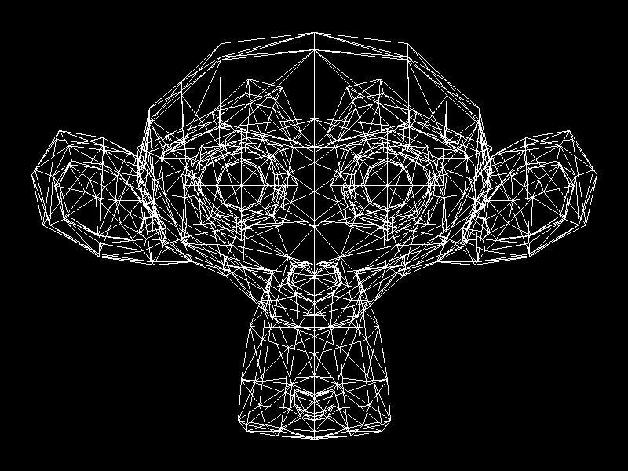

# Laboratorio 4: Carga de modelos

Gráficas por computadora. Hecho en Zig 0.16.0 con raylib.

Se carga un modelo `.obj` (el mono de Blender, triangulado) y se muestra en **wireframe**: solo las aristas de cada triángulo, dibujadas con líneas propias, sin usar funciones de dibujo de raylib ni raylib 3D.



## Cómo funciona

1. **Modelo:** `src/mono.obj`, exportado desde Blender con las caras triangularizadas.
2. **Lectura del `.obj`** (`src/obj.zig`): se recorre el texto línea por línea.
   - `v x y z` es un vértice.
   - `f a/b/c ...` es una cara triangular; solo se usa el índice del vértice (el primer número), restándole 1 porque el formato cuenta desde 1.
3. **Ajuste a pantalla** (`src/view.zig`): se centra el modelo, se escala para que quepa en la ventana con margen, y se voltea la Y porque en pantalla crece hacia abajo. Es una proyección ortogonal: la z no se usa para posicionar.
4. **Líneas** (`src/line.zig`): algoritmo de Bresenham, escribiendo píxel por píxel en el framebuffer. Los píxeles fuera de pantalla se ignoran.
5. **Wireframe** (`src/main.zig`): por cada cara se dibujan sus 3 aristas (a→b, b→c, c→a). La imagen se guarda en `wireframe.png`.

Otros archivos: `src/framebuffer.zig` (framebuffer del curso) y `src/vec3.zig` (vector 3D).

## Cómo correrlo

```
zig build run -Doptimize=ReleaseFast
```

Al iniciar se genera `wireframe.png`.
